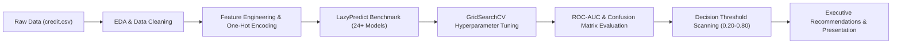

# Credit Risk Prediction & Default Analysis

**Author:** Abubakar Iqbal  
**Program:** NAVTTC / NIAI (NETSOL Technologies)  
**Role:** Machine Learning Analyst  
**Dataset:** `credit.csv` (1,000 applicant records, 21 financial, demographic & behavioral features)  
**Deliverables:**
- In-depth Jupyter Notebook: [`credit_risk.ipynb`](credit_risk.ipynb)
- Executive Presentation Deck: [`credit_risk_presentation.pptx`](credit_risk_presentation.pptx)
- Formal Project Specification: [`Project.pdf`](Project.pdf)
- Complete Submission Archive: [`Credit_Risk.zip`](../Credit_Risk.zip)

---

## 1. Executive Summary & Business Context
In commercial banking, **Credit Default Risk** is the primary driver of financial loss—occurring when a borrower fails to meet statutory loan obligations. The primary objective of this project is to construct, benchmark, tune, and optimize end-to-end predictive machine learning models that categorize applicants into:
- **Good Loans (Class 0):** Creditworthy applicants approved for financing.
- **Bad / Defaulting Loans (Class 1):** High-risk applicants exhibiting elevated probability of delinquency.

### Core Strategic Trade-off:
$$\text{Minimize False Negatives (Costly Defaults)} \quad \text{vs.} \quad \text{Control False Positives (Lost Revenue)}$$

---

## 2. Dataset Overview & Key Variables
The dataset comprises 1,000 historical loan applicants across 21 multi-dimensional indicators:
* **Target Variable:** `default` (0 = Non-default / Good, 1 = Default / Bad).
* **Financial Liquidity:** `checking_balance`, `savings_balance`, `existing_credits`.
* **Repayment Commitments:** `installment_rate` (% of disposable income), `installment_plan`, `credit_amount`, `duration`.
* **Demographics & Stability:** `age`, `employment_duration`, `housing_status`, `personal_status` (gender/marital status), `dependents`.

---

## 3. End-to-End Machine Learning Workflow

1. **Exploratory Data Analysis (EDA):**
   - Univariate default distributions and demographic splits.
   - Bivariate relationship of checking account balances, savings, and past credit history against default probability.
   - Pearson correlation heatmap for numeric attributes.

2. **Feature Engineering & Cleaning:**
   - Removal of observation IDs and uninformative identifiers.
   - Duration conversions and median/modal imputation.
   - Categorical dummy encoding (`pd.get_dummies`) and feature normalization with `StandardScaler`.

3. **Automated Model Benchmarking:**
   - Multi-classifier evaluation across 24+ estimators via `LazyClassifier` (LazyPredict).

4. **Systematic Hyperparameter Tuning (GridSearchCV):**
   - Cross-validated grid search on Logistic Regression, Decision Trees, Random Forest, AdaBoost, and Gradient Boosting Classifiers.
   - Evaluation on balanced accuracy, F1-score, and ROC-AUC metrics.

5. **Threshold Optimization & Risk Tuning:**
   - Threshold scanning from $p=0.20$ to $p=0.80$ to find optimal cutoff reducing bank default exposure while maintaining customer acquisition.

---

## 4. Key Results & Recommendation
- **Champion Model:** Tuned **Random Forest Classifier** achieved the highest combined ROC-AUC and stability against cross-validation folds.
- **Optimal Decision Threshold:** Lowering the default classification threshold to $p \approx 0.35$ drastically enhances recall on defaulting loans, preventing toxic bad debt write-offs with negligible impact on overall approval volume.
